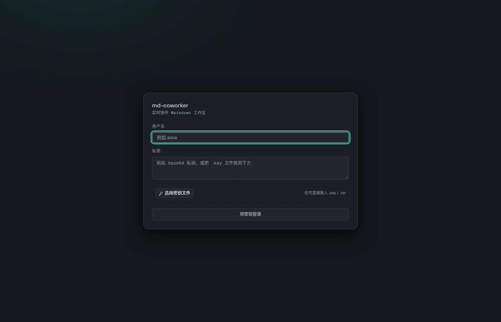
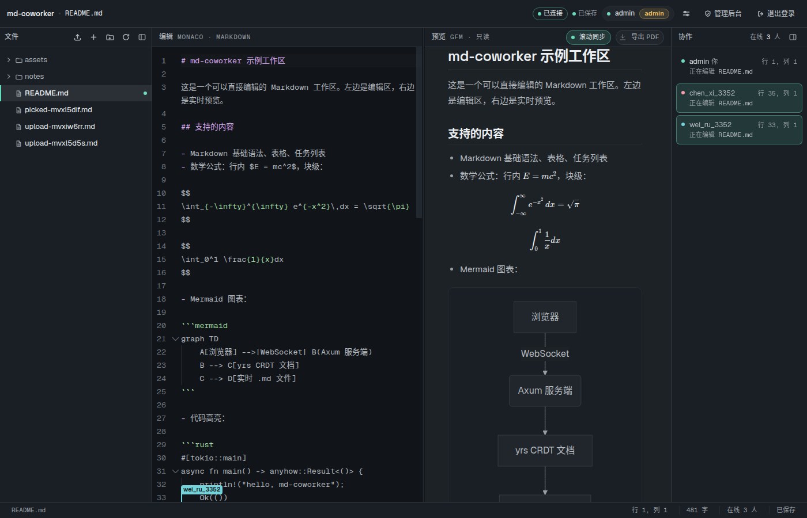
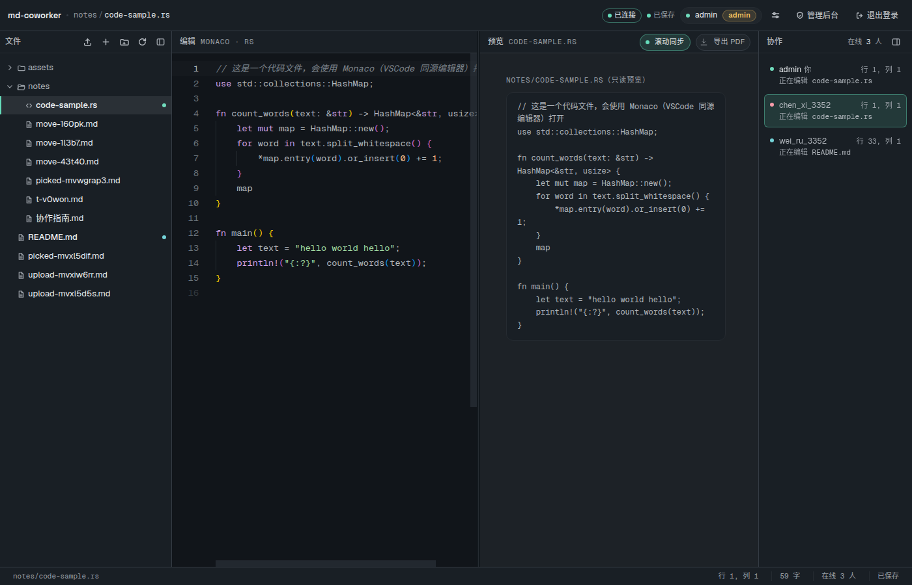
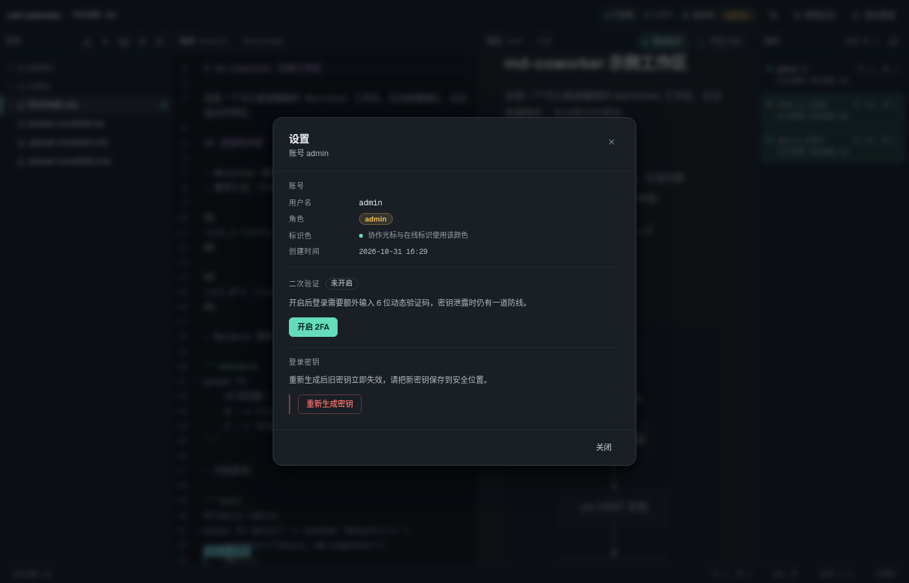
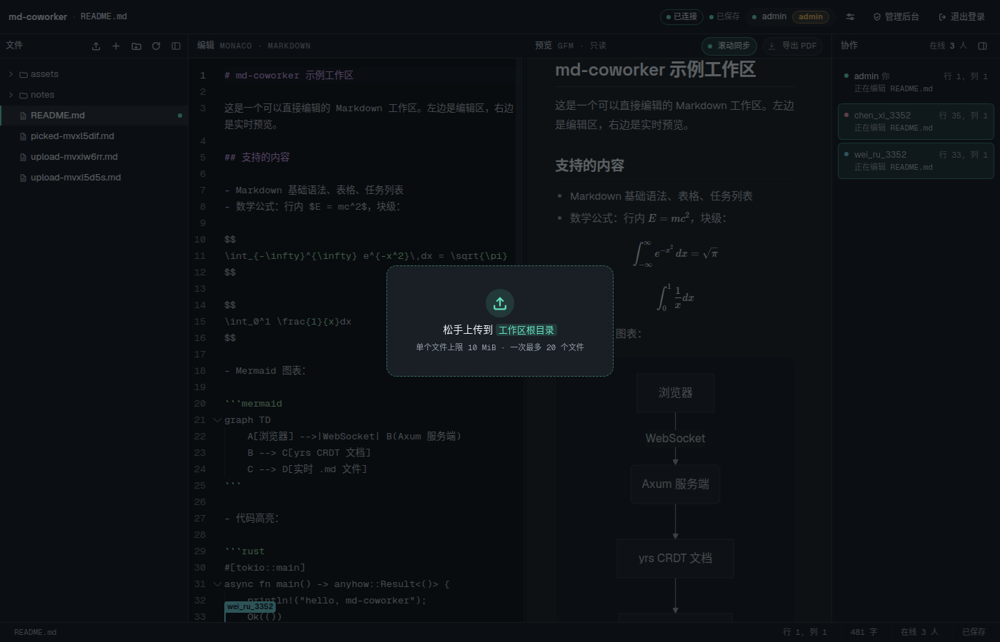
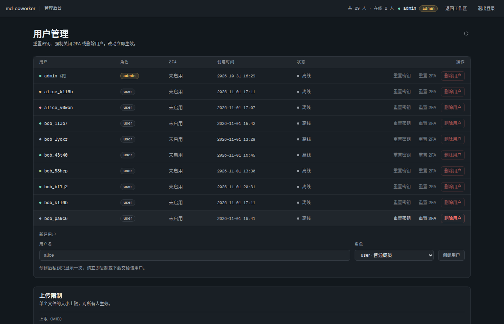

# Markdown Coworker

基于 **Axum** 的实时协作 Markdown 工作区：
密钥对登录、左侧编辑 / 右侧预览、可折叠文件树，以及对任意文本文件使用 Monaco（VSCode 同源编辑器）在线编辑。
协作部分使用 **CRDT（Yjs ⇄ yrs）**，编辑内容实时保存，**无需手动保存**，且撤销只作用于自己的编辑。
图片、PDF、代码等附件可以直接拖进窗口上传，单文件大小上限由管理员设置。

```
浏览器 (Monaco + Yjs)
        │  WebSocket (JSON + base64 二进制帧)
        ▼
Axum (0.8) ── yrs 文档房间 ── 400ms 防抖保存 ──▶ 工作区目录里的 .md / .rs / …
        │
        └── PostgreSQL（sqlx）：用户 / 会话 / 2FA 种子，敏感字段 AES-256-GCM 加密
```





## 快速开始

```bash
# 用 just（推荐）
just install     # 前端 + 测试脚本依赖
just web         # 构建前端产物到 web/dist
just db-up       # 启动项目自带的 PostgreSQL 集群（首次会 initdb + createdb）
just run         # release 构建并启动；第一个参数就是工作区目录

# 或者直接手敲
cd web && npm install && npm run build && cd ..
DATABASE_URL=postgres://md_coworker@127.0.0.1:5433/md_coworker \
  cargo run --release -- ./demo-workspace --bind 127.0.0.1:3000
```

需要 1 个可用的 PostgreSQL。仓库不内置数据库：
`just db-up` 会用 `PG_BIN`（默认 `/usr/lib/postgresql/18/bin`）在 `data/pg` 建一个
**只监听 127.0.0.1:5433、trust 认证、仅供本项目使用**的独立集群；
连自己的数据库只要设 `DATABASE_URL` 或传 `--database-url`，表结构会在启动时自动创建。

首次启动会自动创建 `admin` 账号，把私钥打印在终端并写入 `data/bootstrap-admin.key`。**该私钥只出现这一次**，服务端不保存私钥，请立刻转存到密码管理器。

打开 <http://127.0.0.1:3000>，用「用户名 + 私钥」登录即可。

### 命令行参数

| 参数 | 说明 |
| --- | --- |
| `<工作区目录>`（位置参数，必填） | 所有文件操作都被限制在该目录内 |
| `--bind <地址>` | 监听地址，默认 `127.0.0.1:3000` |
| `--database-url <URL>` | PostgreSQL 连接串，默认取环境变量 `DATABASE_URL`，再回退 `postgres://md_coworker@127.0.0.1:5433/md_coworker` |
| `--data <目录>` | 主密钥与 CRDT 快照目录，默认 `./data`（数据表在 PostgreSQL 里） |
| `--static <目录>` | 前端产物目录，默认 `web/dist` |
| `--session-ttl <小时>` | 会话有效期，默认 168 |

环境变量 `MC_LOG` 可调日志级别（默认 `md_coworker=info`）。

## 账号与登录

- 登录使用 Ed25519 签名：服务端下发随机 nonce，客户端用私钥签名，服务端用公钥验签。
- 私钥使用 32 字节种子（base64），只存在于用户手里；服务端只保存公钥。
- 管理员在「用户管理」里创建用户，创建成功后私钥**只显示一次**（可下载 `.key` 文件）。
- 任何用户都可以在设置里**重新生成密钥对**，旧私钥立即失效。
- 用户可自行开启 TOTP 2FA（扫码或手输密钥），开启后登录需要「私钥签名 + 6 位动态码」两步。
- 会话保存在 HttpOnly Cookie（`mc_sid`，SameSite=Lax）里，服务端只存其 SHA-256。

## 文件上传

- 3 种入口：拖拽文件到窗口任意位置、文件树右上角的上传按钮、`Mod+Shift+U`。目标目录取当前选中的
  文件所在目录（选中目录则用它自己，没有选中就是工作区根）。
- 上传按块流式写入临时文件，超过上限立刻中断并删除临时文件，**不会留下半个文件**。同名文件默认报 `409`，确认后可以覆盖。
- 上限由管理员在「用户管理 → 上传限制」里设置，存于 PostgreSQL 的 `settings.max_upload_bytes`，
  默认 10 MiB，范围 1 KiB–512 MiB；普通用户通过 `GET /api/settings` 读取同 1 个值，前端上传前先自检。
- 支持的附件不限于图片：`/api/raw` 按扩展名（必要时按魔数）返回正确的 `Content-Type`，
  未知类型按 `application/octet-stream` + `attachment` 下发；SVG 额外加 `sandbox` CSP，防止内联脚本。
- Markdown 里的相对图片路径（``）在预览时会被改写成 `/api/raw?path=…`，
  `http(s)://`、`data:` 与站内绝对路径保持原样。

## 协作模型

- 每个文件在服务端对应 1 个 `yrs::Doc`（Yjs 的 Rust 实现），根 Y.Text 名为 `content`，是全量历史。
- 客户端 `join` 1 个文件 → 收到 `init`（当前状态全量更新）→ 之后互发增量更新。
- 服务端 400ms 防抖把文档文本写回磁盘；即使进程崩溃，最多丢 400ms 的输入。
  房间没人时会立刻保存并把文档从内存回收，下次进入从加密快照恢复历史（Undo 不会因重连而错乱）。
- **撤销**：客户端只用 `UndoManager` 跟踪本地来源的编辑（`origin === null`），远端更新带 `origin = 'remote'`，
  因此 `Ctrl/Cmd+Z` 只能撤回自己的编辑，撤回不了别人的。
- **在线感知**（核心功能）：`presence` 帧携带「我在哪个文件 + 光标行列 + 选区长度」，服务端按 1s 汇总广播，
  右侧面板会列出在线用户、其文件与位置，点击可直接跳转；文件树里也会标记「谁在编辑这个文件」。

## 安全说明

- 路径参数 1 律按工作区根目录解析，拒绝 `..`、绝对路径与符号链接逃逸（解析结果会做
  `canonicalize` 前缀校验）；任何以 `.` 开头的路径组件（`.env`、`.git/config`、`.data/...`） 1 律 `400 bad_path`，隐藏文件不再"隐藏但可读"。
- `--data`（主密钥与 CRDT 快照）必须放在工作区之外，否则拒绝启动；该目录在 Unix 上权限为 `0700`。
- 参与协作的文件在有人编辑时禁止重命名 / 删除（返回 `409 file_busy`），避免文档与磁盘错位；
  重命名/删除执行期间对路径加写锁，期间的 `join` 同样得到 `409 file_busy`。
- 2FA 种子、CRDT 快照等在磁盘/数据库里都是密文；主密钥 `data/master.key` 权限 0600。
- 上传只接受文件名最后 1 段（`/`、`\` 之后的部分），拒绝空名、`.`、`..`、以 `.` 开头的隐藏名与超长名；
  上传大小在流式写入时按管理员设定逐块校验，超限即中断。
- `/api/raw` 需要登录态， 1 律带 `X-Content-Type-Options: nosniff`；SVG 带
  `Content-Security-Policy: …; sandbox`，不会以本站身份执行脚本。
- 会话令牌在数据库里也只存 SHA-256；`sessions` / `challenges` / `mfa_tickets` 都带过期时间，
  过期即失效并由后台任务回收。
- 登录 / 2FA 接口有令牌桶限流（同 1 用户名 60 秒内 10 次失败上限，`/challenge` 全局每分钟 60 次），
  超限返回 `429 rate_limited` 并带 `Retry-After`；同一张 2FA 票据连续输错 5 次即作废。
- 自助重置密钥时，启用 2FA 的账号必须提供当前验证码，成功后除当前会话外的所有会话立即失效。
- 页面统 1 带 `Content-Security-Policy`（无第 3 方脚本、无 `eval`、禁止被外站 iframe），
  `/ws` 握手校验 `Origin` 与 `Host` 一致（跨站 WebSocket 劫持防护）。
- 单文件读取上限 100 MiB，超出返回 `413 too_large`；文件树跳过符号链接并限制深度与条目数。
- **传输层不在本程序内**：默认监听 `0.0.0.0`（`BIND`）只方便局域网访问，服务只依赖 HTTP。
  对外暴露时请放在 TLS 反向代理之后，并加 `--secure-cookies`（或让代理发
  `X-Forwarded-Proto: https`）使会话 Cookie 带上 `Secure`；局域网内可用 `just port-proxy`
  打印 WSL → Windows 的端口转发命令。

### 数据存储

关系型数据在 PostgreSQL，文档内容仍是磁盘上的文件（+ `data/crdt/` 里的加密快照）：

| 表 | 内容 | 清理 |
| --- | --- | --- |
| `users` | 用户名、角色、presence 颜色、公钥、加密的 TOTP 种子 | 管理员删除 |
| `sessions` | 会话令牌的 SHA-256、创建/过期时间 | 过期即失效，后台 10 分钟回收 |
| `challenges` | 登录挑战 nonce（一次性） | 验签后立即删除 |
| `mfa_tickets` | 通过第一因子后签发的 2FA 票据 | 用完即删 / 5 分钟过期 |
| `settings` | 管理员可调的运行时配置（当前是上传大小上限） | 有默认值，随时可改 |

表结构由 `src/db.rs` 里的 `CREATE TABLE IF NOT EXISTS` 在启动时保证，`just db-status` 可以随时查看。

## 界面

| 登录 | 工作区（三人在同一份文档里） |
| --- | --- |
|  |  |

| 代码文件（Monaco） | 设置 |
| --- | --- |
|  |  |

| 拖拽上传 | 管理后台（含上传上限） |
| --- | --- |
|  |  |

## 项目结构

```
src/
  main.rs       启动、管理员初始化、优雅退出
  config.rs     命令行参数与目录/主密钥
  error.rs      anyhow 封装为 HTTP 响应
  crypto.rs     HKDF / AES-256-GCM / Ed25519 / base32 / TOTP
  db.rs         sqlx + PostgreSQL：用户、会话、挑战、2FA 票据（启动时建表）
  auth.rs       登录、2FA、密钥轮换
  admin.rs      用户管理
  files.rs      工作区文件树与读写
  upload.rs     流式上传与 /api/raw 原始资源
  settings.rs   管理员可调的运行时配置
  collab.rs     WebSocket + yrs 文档房间 + 保存 + presence
  api.rs        路由装配、静态资源托管
web/            前端
tools/          端到端冒烟测试、真浏览器测试、截图
docs
  protocol.md   前后端协议契约
docs
  design.md     前端视觉/交互规范
```

## 测试

```bash
just test        # 单元测试：HKDF / AES / Ed25519 / base32 / TOTP
just smoke       # 端到端接口 + WebSocket：登录、文件、双客户端协作、presence、2FA、密钥轮换
just browser     # Chromium 双窗口：登录、预览渲染、实时同步、在线面板、撤销隔离
```

`smoke` / `browser` 需要服务已在 `BIND` 上运行，
并先 `just install` 装好 `web/` 与 `tools/` 的 npm 依赖。

## 常用命令

本项目用 [just](https://github.com/casey/just) 管理任务，`just` 或 `just --list` 可看全部：

```bash
just install     # 安装 web/ 与 tools/ 的 npm 依赖
just web         # 构建前端到 web/dist
just release     # release 构建后端
just run         # release 构建并启动
just dev         # debug 构建并启动
just test        # cargo test
just smoke       # 接口冒烟测试
just browser     # 真浏览器测试
just shots       # 重新生成 docs/screenshots
just fmt         # cargo fmt
just db-up       # 启动本地 PostgreSQL
just db-down     # 停止本地集群
just db-status   # 查询表和用户数量
just db-psql     # 手动查表
just db-reset    # 丢掉本地集群重建（清空所有用户）
just clean       # 停库 + cargo clean + 删除 web/dist 与 data
```
