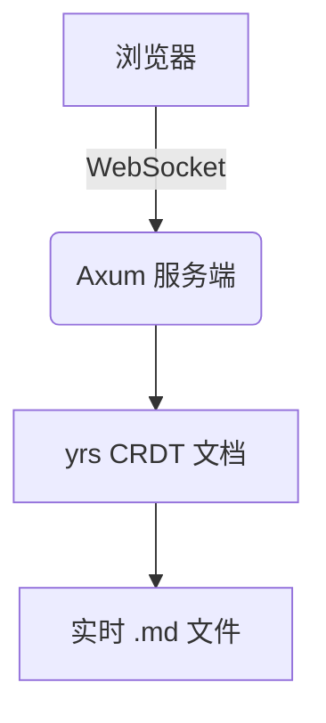
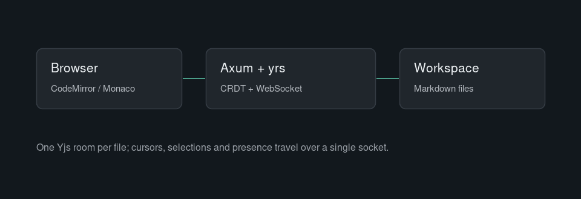

# md-coworker 示例工作区

这是一个可以直接编辑的 Markdown 工作区。左边是编辑区，右边是实时预览。

## 支持的内容

- Markdown 基础语法、表格、任务列表
- 数学公式：行内 $E = mc^2$，块级：

$$
\int_{-\infty}^{\infty} e^{-x^2}\,dx = \sqrt{\pi}
$$

- Mermaid 图表：



- 代码高亮：

```rust
#[tokio::main]
async fn main() -> anyhow::Result<()> {
    println!("hello, md-coworker");
    Ok(())
}
```

> 打开两个浏览器窗口，用不同账号登录同一个文件，可以看到彼此的光标与编辑。

## 图片与上传

把图片、PDF、代码文件直接拖到窗口里，或者点文件树右上角的上传按钮，就会存进工作区
（默认放到当前选中的目录）。下面是上传进 `assets/` 的示意图，用相对路径引用：



单个文件的大小上限由管理员在“用户管理 → 上传限制”里设置，默认 10 MiB。

## 表格与任务列表

| 文件类型 | 编辑器 |
| --- | --- |
| `.md` / `.markdown` | CodeMirror 6 + 实时预览 |
| 其它文本文件 | Monaco（VSCode 内核） |

两种编辑器接的是同一个 CRDT 文档，所以协作、保存、撤销的行为完全一致。

- [x] 密钥对登录（不支持密码）
- [ ] 打开设置，给账号开启 TOTP 二次验证
- [ ] 叫上一位同事，同时编辑这份文件

## 试试协作

1. 打开第二个浏览器窗口，用另一个账号登录。
2. 两个窗口打开本文件，注意右侧协作者栏与文件树上的圆点。
3. 各自输入几行字：内容实时合并，**不需要手动保存**。
4. 按 `Ctrl/Cmd + Z`：只会撤回自己的编辑，动不到别人的。


### dahgasd

asdd
