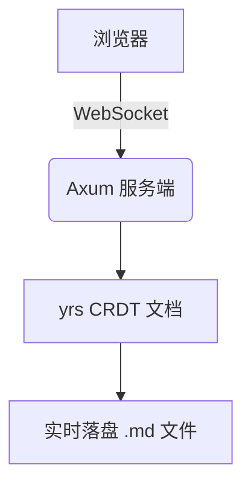

# md-coworker 示例工作区

这是一个可以直接编辑的 Markdown 工作区。左边是编辑区，右边是实时预览。

## 支持的内容

- Markdown 基础语法、表格、任务列表
- 数学公式：行内 $E = mc^2$，块级：

$$
\int_{-\infty}^{\infty} e^{-x^2}\,dx = \sqrt{\pi}
$$

- Mermaid 图表：



- 代码高亮：

```rust
#[tokio::main]
async fn main() -> anyhow::Result<()> {
    println!("hello, md-coworker");
    Ok(())
}
```

> 打开两个浏览器窗口，用不同账号登录同一个文件，可以看到彼此的光标与编辑。
